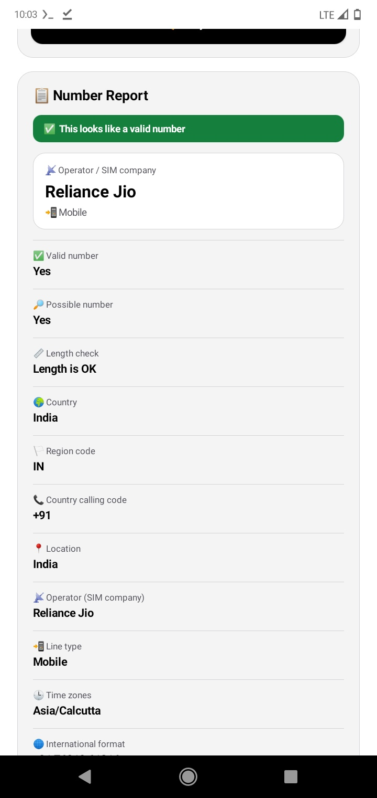

  

<h1 align="center">📞 Phone Number Information</h1>

  An offline Android app that tells you everything the public numbering data knows about a phone number. 
  Pick a country, type the number, get a clean report.

  

## 📸 Screenshot

  

## ✨ Features

- 🌍 **All countries supported**: searchable country list with flags
- ➕ **Dial code added automatically**: choose India and `+91` is filled in for you
- ✅ **Validity check**: valid / possible number and length check
- 📡 **Operator (SIM company)**: for example Reliance Jio, Airtel, Vi, Grameenphone, Robi
- 📲 **Line type**: mobile, landline, toll free, VoIP and more
- 📍 **Country, region code and location**
- 🕒 **Time zones**
- 🔢 **Every format**: International, National, E.164 and RFC3966
- 📋 **One-tap copy** of the full report
- 🎨 **Black and white theme** that follows your phone's light or dark mode
- 👋 **Welcome screen** on first launch
- 🔒 **100% offline**: no internet, no permissions, no tracking

## 🚀 How to use

1. Open the app and tap **Get Started**.
2. Tap the **Country** box and choose your country (use search to find it fast).
3. The dial code appears automatically, so **do not type it again**.
4. Type only the phone number in the box.
5. Tap **Analyze**, wait for the spinner, and read your report.

### 🧪 Example numbers

| Country | Choose | Type this (replace each `X` with a digit) |
|---|---|---|
| 🇮🇳 India | India (+91) | `98XXXXXXXX` |
| 🇧🇩 Bangladesh | Bangladesh (+880) | `17XXXXXXXX` (a leading `0` is fine too) |
| 🇺🇸 United States | United States (+1) | `2015550123` |
| 🇬🇧 United Kingdom | United Kingdom (+44) | `7XXXXXXXXX` |

You can also type a full international number starting with `+`, for example `+91 98XXXXXXXX`, and the app will read the country from it.

## 🌐 Supported countries

- 🇦🇫 Afghanistan
- 🇦🇱 Albania
- 🇩🇿 Algeria
- 🇦🇸 American Samoa
- 🇦🇩 Andorra
- 🇦🇴 Angola
- 🇦🇮 Anguilla
- 🇦🇬 Antigua & Barbuda
- 🇦🇷 Argentina
- 🇦🇲 Armenia
- 🇦🇼 Aruba
- 🇦🇨 Ascension Island
- 🇦🇺 Australia
- 🇦🇹 Austria
- 🇦🇿 Azerbaijan
- 🇧🇸 Bahamas
- 🇧🇭 Bahrain
- 🇧🇩 Bangladesh
- 🇧🇧 Barbados
- 🇧🇾 Belarus
- 🇧🇪 Belgium
- 🇧🇿 Belize
- 🇧🇯 Benin
- 🇧🇲 Bermuda
- 🇧🇹 Bhutan
- 🇧🇴 Bolivia
- 🇧🇦 Bosnia & Herzegovina
- 🇧🇼 Botswana
- 🇧🇷 Brazil
- 🇮🇴 British Indian Ocean Territory
- 🇻🇬 British Virgin Islands
- 🇧🇳 Brunei
- 🇧🇬 Bulgaria
- 🇧🇫 Burkina Faso
- 🇧🇮 Burundi
- 🇰🇭 Cambodia
- 🇨🇲 Cameroon
- 🇨🇦 Canada
- 🇨🇻 Cape Verde
- 🇧🇶 Caribbean Netherlands
- 🇰🇾 Cayman Islands
- 🇨🇫 Central African Republic
- 🇹🇩 Chad
- 🇨🇱 Chile
- 🇨🇳 China
- 🇨🇽 Christmas Island
- 🇨🇨 Cocos (Keeling) Islands
- 🇨🇴 Colombia
- 🇰🇲 Comoros
- 🇨🇬 Congo - Brazzaville
- 🇨🇩 Congo - Kinshasa
- 🇨🇰 Cook Islands
- 🇨🇷 Costa Rica
- 🇭🇷 Croatia
- 🇨🇺 Cuba
- 🇨🇼 Curaçao
- 🇨🇾 Cyprus
- 🇨🇿 Czechia
- 🇨🇮 Côte d’Ivoire
- 🇩🇰 Denmark
- 🇩🇯 Djibouti
- 🇩🇲 Dominica
- 🇩🇴 Dominican Republic
- 🇪🇨 Ecuador
- 🇪🇬 Egypt
- 🇸🇻 El Salvador
- 🇬🇶 Equatorial Guinea
- 🇪🇷 Eritrea
- 🇪🇪 Estonia
- 🇸🇿 Eswatini
- 🇪🇹 Ethiopia
- 🇫🇰 Falkland Islands
- 🇫🇴 Faroe Islands
- 🇫🇯 Fiji
- 🇫🇮 Finland
- 🇫🇷 France
- 🇬🇫 French Guiana
- 🇵🇫 French Polynesia
- 🇬🇦 Gabon
- 🇬🇲 Gambia
- 🇬🇪 Georgia
- 🇩🇪 Germany
- 🇬🇭 Ghana
- 🇬🇮 Gibraltar
- 🇬🇷 Greece
- 🇬🇱 Greenland
- 🇬🇩 Grenada
- 🇬🇵 Guadeloupe
- 🇬🇺 Guam
- 🇬🇹 Guatemala
- 🇬🇬 Guernsey
- 🇬🇳 Guinea
- 🇬🇼 Guinea-Bissau
- 🇬🇾 Guyana
- 🇭🇹 Haiti
- 🇭🇳 Honduras
- 🇭🇰 Hong Kong SAR China
- 🇭🇺 Hungary
- 🇮🇸 Iceland
- 🇮🇳 India
- 🇮🇩 Indonesia
- 🇮🇷 Iran
- 🇮🇶 Iraq
- 🇮🇪 Ireland
- 🇮🇲 Isle of Man
- 🇮🇱 Israel
- 🇮🇹 Italy
- 🇯🇲 Jamaica
- 🇯🇵 Japan
- 🇯🇪 Jersey
- 🇯🇴 Jordan
- 🇰🇿 Kazakhstan
- 🇰🇪 Kenya
- 🇰🇮 Kiribati
- 🇽🇰 Kosovo
- 🇰🇼 Kuwait
- 🇰🇬 Kyrgyzstan
- 🇱🇦 Laos
- 🇱🇻 Latvia
- 🇱🇧 Lebanon
- 🇱🇸 Lesotho
- 🇱🇷 Liberia
- 🇱🇾 Libya
- 🇱🇮 Liechtenstein
- 🇱🇹 Lithuania
- 🇱🇺 Luxembourg
- 🇲🇴 Macao SAR China
- 🇲🇬 Madagascar
- 🇲🇼 Malawi
- 🇲🇾 Malaysia
- 🇲🇻 Maldives
- 🇲🇱 Mali
- 🇲🇹 Malta
- 🇲🇭 Marshall Islands
- 🇲🇶 Martinique
- 🇲🇷 Mauritania
- 🇲🇺 Mauritius
- 🇾🇹 Mayotte
- 🇲🇽 Mexico
- 🇫🇲 Micronesia
- 🇲🇩 Moldova
- 🇲🇨 Monaco
- 🇲🇳 Mongolia
- 🇲🇪 Montenegro
- 🇲🇸 Montserrat
- 🇲🇦 Morocco
- 🇲🇿 Mozambique
- 🇲🇲 Myanmar (Burma)
- 🇳🇦 Namibia
- 🇳🇷 Nauru
- 🇳🇵 Nepal
- 🇳🇱 Netherlands
- 🇳🇨 New Caledonia
- 🇳🇿 New Zealand
- 🇳🇮 Nicaragua
- 🇳🇪 Niger
- 🇳🇬 Nigeria
- 🇳🇺 Niue
- 🇳🇫 Norfolk Island
- 🇰🇵 North Korea
- 🇲🇰 North Macedonia
- 🇲🇵 Northern Mariana Islands
- 🇳🇴 Norway
- 🇴🇲 Oman
- 🇵🇰 Pakistan
- 🇵🇼 Palau
- 🇵🇸 Palestinian Territories
- 🇵🇦 Panama
- 🇵🇬 Papua New Guinea
- 🇵🇾 Paraguay
- 🇵🇪 Peru
- 🇵🇭 Philippines
- 🇵🇳 Pitcairn Islands
- 🇵🇱 Poland
- 🇵🇹 Portugal
- 🇵🇷 Puerto Rico
- 🇶🇦 Qatar
- 🇷🇴 Romania
- 🇷🇺 Russia
- 🇷🇼 Rwanda
- 🇷🇪 Réunion
- 🇼🇸 Samoa
- 🇸🇲 San Marino
- 🇨🇶 Sark
- 🇸🇦 Saudi Arabia
- 🇸🇳 Senegal
- 🇷🇸 Serbia
- 🇸🇨 Seychelles
- 🇸🇱 Sierra Leone
- 🇸🇬 Singapore
- 🇸🇽 Sint Maarten
- 🇸🇰 Slovakia
- 🇸🇮 Slovenia
- 🇸🇧 Solomon Islands
- 🇸🇴 Somalia
- 🇿🇦 South Africa
- 🇬🇸 South Georgia & South Sandwich Islands
- 🇰🇷 South Korea
- 🇸🇸 South Sudan
- 🇪🇸 Spain
- 🇱🇰 Sri Lanka
- 🇧🇱 St. Barthélemy
- 🇸🇭 St. Helena
- 🇰🇳 St. Kitts & Nevis
- 🇱🇨 St. Lucia
- 🇲🇫 St. Martin
- 🇵🇲 St. Pierre & Miquelon
- 🇻🇨 St. Vincent & Grenadines
- 🇸🇩 Sudan
- 🇸🇷 Suriname
- 🇸🇯 Svalbard & Jan Mayen
- 🇸🇪 Sweden
- 🇨🇭 Switzerland
- 🇸🇾 Syria
- 🇸🇹 São Tomé & Príncipe
- 🇹🇼 Taiwan
- 🇹🇯 Tajikistan
- 🇹🇿 Tanzania
- 🇹🇭 Thailand
- 🇹🇱 Timor-Leste
- 🇹🇬 Togo
- 🇹🇰 Tokelau
- 🇹🇴 Tonga
- 🇹🇹 Trinidad & Tobago
- 🇹🇦 Tristan da Cunha
- 🇹🇳 Tunisia
- 🇹🇲 Turkmenistan
- 🇹🇨 Turks & Caicos Islands
- 🇹🇻 Tuvalu
- 🇹🇷 Türkiye
- 🇻🇮 U.S. Virgin Islands
- 🇺🇬 Uganda
- 🇺🇦 Ukraine
- 🇦🇪 United Arab Emirates
- 🇬🇧 United Kingdom
- 🇺🇸 United States
- 🇺🇾 Uruguay
- 🇺🇿 Uzbekistan
- 🇻🇺 Vanuatu
- 🇻🇦 Vatican City
- 🇻🇪 Venezuela
- 🇻🇳 Vietnam
- 🇼🇫 Wallis & Futuna
- 🇪🇭 Western Sahara
- 🇾🇪 Yemen
- 🇿🇲 Zambia
- 🇿🇼 Zimbabwe
- 🇦🇽 Åland Islands

> The exact list can differ slightly depending on the library version bundled in the app.

## ℹ️ Good to know

- The operator is found from the number's **prefix range**. If a number was moved to another network (number portability), the app may show the **original** operator.
- Location is usually just the country for mobile numbers. Landline numbers often show a city or region.
- This app does **not** reveal the owner's name, address or live location. That information is not part of public numbering data, and the app is not built for tracking people.

## 🔐 Privacy

No permissions are requested. Numbers you type are processed on your device only and are never stored or sent anywhere.

## ⚖️ Disclaimer

For education and general information only. Please use it responsibly and respect other people's privacy.
